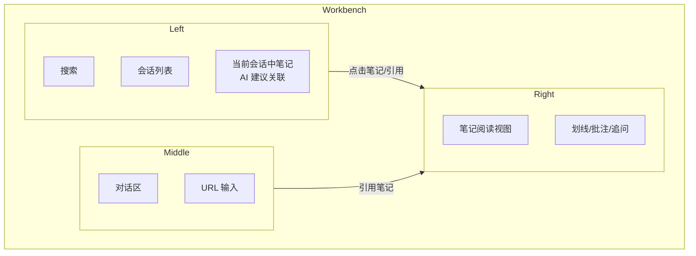
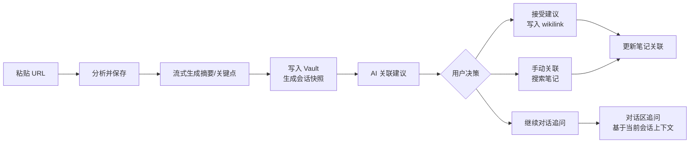
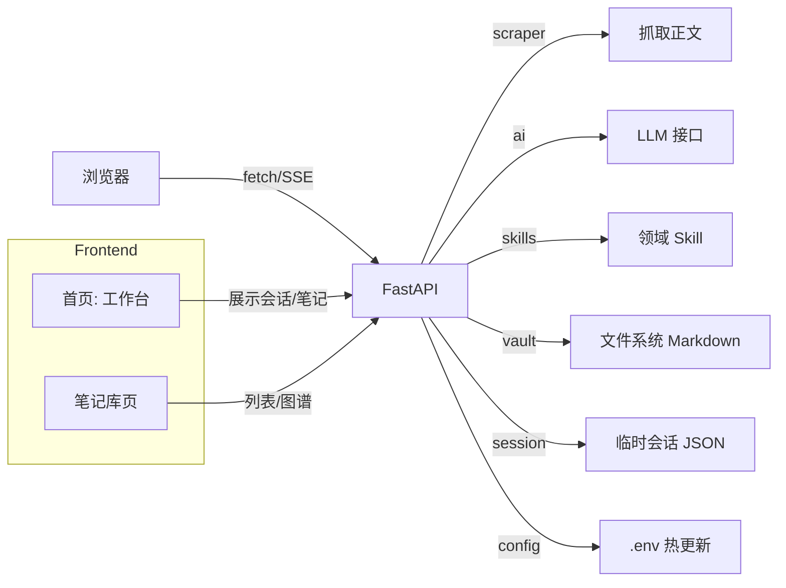

下面我直接基于你给的 PRD 文本，结合之前我们讨论的“左侧会话 + 右侧笔记 + 独立笔记库页 + 竞品对比 + 交互优化”等，帮你做一版结构化优化。整体思路是：
- 保留你原有技术实现和字段结构，尽量不破坏已有逻辑。
- 把布局改成“工作台 + 笔记库”两个页面，更符合你之前构想。
- 明确核心交互流程、状态与权限模型。
- 补充竞品、指标、安全与数据治理。
---
# 知识聚合器 PRD（优化版）
> 用途：基于当前实现整理产品全貌，作为后续迭代的基线。  
> 最后更新：2026-07-21。
---
## 1. 产品定位
**一句话**：  
粘贴网页链接，AI 自动整理成结构化 Markdown 笔记，并基于会话和知识库智能建议关联，用 `[[wikilink]]` 逐步构建个人知识网络。
**目标用户**：
- 使用 Markdown 做知识管理的人（Obsidian / Logseq 用户）。
- 经常收藏网页、公众号、论文，但“存完就忘”的人。
- 希望通过 AI 建立跨笔记知识连接，而不是手动维护图谱的人。
**核心价值**：
1. 省去「读完网页 → 手写笔记 → 手动打标签 → 想关联哪些旧笔记」的全套手工流程。
2. 领域感知的摘要：技术文突出架构、教程突出步骤、产品文突出商业模式。
3. AI 建议关联 + 一键 `[[wikilink]]`，让知识网络自然生长。
4. 以“会话”为单位组织一次知识对话，既可对话追问，又能沉淀成可复用的笔记资产。
---
## 2. 竞品与差异定位（新增）
| 产品 | 类型 | 优点 | 局限（你的机会） |
|------|------|------|------------------|
| Cubox | 稍后阅读 + AI 摘要 | 剪藏体验好、阅读视图干净、跨平台支持完善 | 偏静态收藏，AI 多为单篇摘要，缺少长期知识网络与对话式追问。 |
| Mem.ai | AI 原生笔记 | 自动关联、智能组织，适合日常碎片输入 | 输入多为手动笔记，对外部网页内容的“聚合 + 结构化”偏弱。 |
| Heptabase | 白板知识库 | 强可视化、适合研究复杂主题 | 上手成本高，缺少“链接 → 自动结构化笔记”的流式入口。 |
| Felo / Perplexity | AI 搜索引擎 | 实时联网搜索，直接给出答案 | 缺少个人知识沉淀，问完即走，无法形成长期知识资产。 |
**你的差异定位**：
- 入口是“网页链接 + 会话对话”，而不是空白笔记。
- 每一次分析既产出笔记，又作为可复用的会话历史。
- 强调 Markdown 输出 + wikilink，天然与 Obsidian / Logseq 兼容，属于“外挂知识加工厂”。
---
## 3. 功能清单（当前已实现）
> 保持你原有表格，这里只做小排版调整。
### 3.1 核心流水线
| 能力 | 说明 | 状态 |
|------|------|------|
| 网页抓取 | httpx 抓取 + trafilatura/bs4 双策略正文抽取，超长截断 | ✅ |
| AI 分析 | 调 Anthropic 兼容接口，按领域 Skill 输出结构化笔记 | ✅ |
| 流式输出 | 摘要正文逐字流式渲染到页面，生成完成切到结构化视图 | ✅（本次新增） |
| 落盘 vault | 写入 markdown 文件（frontmatter + wikilink + mermaid） | ✅ |
| 关联建议 | AI 从已有笔记候选里挑相关篇目，带理由 + 相关度评分 | ✅ |
| 一键关联 | 勾选建议 → 写 `[[wikilink]]` 到「关联笔记」小节，自动去重 | ✅ |
| 手动关联 | 输入笔记名搜索并添加链接（datalist 候选） | ✅ |
| 重新建议 | 对已落盘笔记重新跑关联建议 | ✅ |
| 会话快照 | 每次分析存 JSON 到系统临时目录，可恢复/清空 | ✅ |
| API 配置页 | 前端热更新 .env（AI 地址/密钥/模型/vault 路径/CORS） | ✅ |
### 3.2 领域 Skills（8 个领域）
技术/工程、教程/指南、产品/商业、金融/数据、学术/研究、资讯/动态、观点/评论、通用。
每个领域定义摘要强调点 + 推荐的 mermaid 图类型。
### 3.3 笔记格式（保持不变）
```markdown
---
title: ...
source: https://...
created: 2026-07-21
domain: tech
tags: [tag1, tag2]
---
# 标题
> **TL;DR**: 一句话总结
## 摘要
（结构化 markdown）
## 关键点
- ...
## 图解
```mermaid
（mermaid 代码）
```
## 关联笔记
- [[其他笔记]]
```
---
## 4. 布局设计（重构为两页式结构）
### 4.1 整体结构
- **首页：工作台（Workbench）**
  - 左侧：会话历史 + 当前会话上下文 + AI 建议关联。
  - 右侧：笔记阅读视图（点击笔记库或对话中引用笔记时展示）。
- **笔记库页（Vault）**
  - 所有笔记列表 / 图谱视图。
  - 支持搜索、筛选、批处理。
### 4.2 首页布局（工作台）

**左侧栏（Left）**：
- 顶部：全局搜索（按关键词 / 标签）。
- 中间：会话列表。
  - 每个会话包含：时间、来源 URL 摘要、关联笔记数。
  - 支持重命名、删除、归档。
- 底部：“当前会话上下文”：
  - 本会话中已关联的笔记列表。
  - AI 建议关联笔记（可点击加入当前会话）。
  - 手动搜索并关联笔记入口。
**中间栏（Middle）**：
- 顶部：URL 输入框（分析并保存）。
- 下方：对话区（ChatGPT 式对话流）。
  - AI 回复中如果引用笔记，以卡片/链接形式展示。
  - 支持对笔记片段进行追问、改写、生成摘要等。
**右侧栏（Right）**：
- 默认：Daily Digest（今日新增笔记、待读、热点主题等）。
- 点击笔记后：笔记阅读视图。
  - 正文阅读、Mermaid 图渲染、划线、批注。
  - 一键“发送到对话”，让 AI 结合该笔记回答问题。
### 4.3 笔记库页（Vault）
- **列表视图**：
  - 按时间/来源/领域/标签排序。
  - 支持多选：批量打标签、批量导出、批量重新建议关联。
- **图谱视图**：
  - 以 `[[wikilink]]` 关系为基础，渲染力导向图。
  - 支持按领域/标签筛选子图。
- **详情侧栏**：
  - 点击某篇笔记，侧栏显示详情（类似首页右侧，但更偏管理视角）。
---
## 5. 核心交互流程（新增）
### 5.1 主要流程一览

### 5.2 关键交互说明
| 用户操作 | 触发位置 | 系统响应 | 状态/数据变更 |
|----------|----------|----------|----------------|
| 粘贴 URL → 分析并保存 | 首页中间栏顶部 | 流式生成 → 写入 Vault → 创建会话快照 | 新增一条会话记录、一条笔记 |
| 点击会话列表 | 左侧栏 | 恢复该会话的分析视图 + 已关联笔记 | 主区域显示分析视图，右侧可展示当前笔记 |
| 点击笔记库列表 | 笔记库页 | 列表选中，右侧展示阅读视图 | 不改变当前会话，只切换阅读内容 |
| 勾选 AI 建议 → 确认关联 | 左侧栏 / 分析区 | 写入 `[[wikilink]]` 到目标笔记的“关联笔记”小节 | 更新 markdown 文件，刷新关联关系 |
| 手动搜索并关联 | 左侧栏下方 | 搜索笔记名，插入 `[[wikilink]]` | 同上 |
| 对话区追问 | 中间栏 | AI 基于当前会话上下文和已关联笔记回答 | 产生新的对话轮次，可引用新的笔记 |
| 在阅读视图划线 → 发送到对话 | 右侧栏 | 将选中片段作为上下文加入对话输入框 | 对话带上片段引用 |
---
## 6. 状态与权限模型（新增）
### 6.1 核心实体
- **User（用户）**：
  - 可选：匿名用户（无账号） / 注册用户（多端同步）。
- **Vault（笔记库）**：
  - 一套 markdown 文件夹（可配 iCloud / Git 同步）。
- **Session（会话）**：
  - 每次分析生成一个会话，包含：来源 URL、笔记 ID、对话历史、快照路径。
- **Note（笔记）**：
  - 一篇 markdown 文件，包含 frontmatter、正文、关联笔记。
### 6.2 状态字段
- `note.status`：`draft`（草稿） / `archived`（归档） / `deleted`（已删除）。
- `session.status`：`active`（活跃） / `archived`（归档）。
### 6.3 权限与可见性
- 用户对自己的 Vault 有完全读写权限。
- 未来支持“共享 Vault”时，增加：
  - `vault.visibility`：`private` / `shared` / `public`。
  - `note.shared_with`：用户/团队粒度。
---
## 7. 技术架构（保留并小优化）
保持你原有架构，仅补充“会话 + 笔记库”相关的数据流：

- 建议新增：
  - `session_manager`：统一管理会话快照的生命周期。
  - `cache`：对 `note_candidates()` 结果做缓存（避免每次全量读所有笔记）。
---
## 8. 待迭代方向（重排优先级）
### P0：公开发布前必须
- 安全：
  - 真实 AI 密钥禁止进入任何公开仓库，禁止出现在前端代码中。
  - 提供部署脚本/文档，明确如何配置密钥和 vault 路径。
- 错误体验：
  - 流式生成中途失败时，支持从断点续传或明确重试。
  - 前端展示清晰的错误状态与错误类型（网络 / AI / 抓取失败）。
### P1：体验提升
- 笔记编辑：
  - 支持在线编辑笔记正文并写回 vault（避免切到 Obsidian 再改）。
- 批量分析：
  - 支持一次粘贴多个 URL，后台队列处理。
- 全文搜索：
  - 基于笔记库内容全文检索（可用后端索引或前端小索引）。
- 知识图谱可视化：
  - 使用已有 `[[wikilink]]` 关系渲染全局图谱（force-directed graph）。
- 导出：
  - 支持单篇 / 全部导出为 Markdown 包。
### P2：智能增强
- 向量检索关联：
  - 用 embedding 做语义相似度召回，替代/补充 AI 关联判断。
- 笔记去重检测：
  - 分析前检查是否已有高度相似笔记，提示用户合并或打标签。
- 多模型支持：
  - 支持切换不同 AI 模型对比摘要质量。
- 自定义 Skill：
  - 用户可自定义领域模板（例如：产品需求文档模板、读书笔记模板）。
### P3：平台化
- 浏览器扩展：
  - 右键当前页面 → 发送到知识聚合器分析。
- 移动端适配 / PWA：
  - 移动端主要支持：查看笔记、对话追问。
- Markdown 插件：
  - 在 Obsidian / VSCode 中直接调用 API，分析当前链接。
---
## 9. 安全与数据治理（新增）
### 9.1 密钥与配置管理
- 所有 AI 密钥通过环境变量或密钥管理服务注入，禁止硬编码。
- 前端配置页只允许更新“允许热更新的字段”（如 vault 路径、模型名），敏感字段通过受控接口写入。
### 9.2 抓取与内容版权
- 抓取行为遵循目标站点的 `robots.txt`，仅做个人学习/研究用途。
- 保存快照时尽量保留原站链接、标题、作者信息，方便溯源。
- 如未来提供公开服务，需评估抓取与存储的版权风险。
### 9.3 数据隐私
- 默认所有数据仅在用户本地 vault 存储，不上传云端。
- 若提供云同步服务，需：
  - 明确数据存储位置、加密方式、访问控制策略。
---
## 10. 核心指标与埋点建议（优化）
### 10.1 使用指标
- 分析成功率、平均耗时、流式首字耗时。
- 关联建议采纳率（确认关联数 / 建议总数）。
- 笔记复访率（阅读视图打开次数 / 笔记数）。
- 会话恢复率（从历史恢复次数 / 总分析次数）。
### 10.2 活跃与留存
- 日活 / 周活用户数（DAU / WAU）。
- 次日/七日/三十日留存率（Day1 / Day7 / Day30 Retention）。
- 平均每次会话对话轮次、平均每笔记被引用次数。
### 10.3 性能与稳定性
- 接口错误率（按类型：抓取 / AI / 文件 IO）。
- 会话快照损坏率（恢复失败次数 / 总恢复次数）。
- 平均 vault 大小、笔记数量上限经验值。
---
