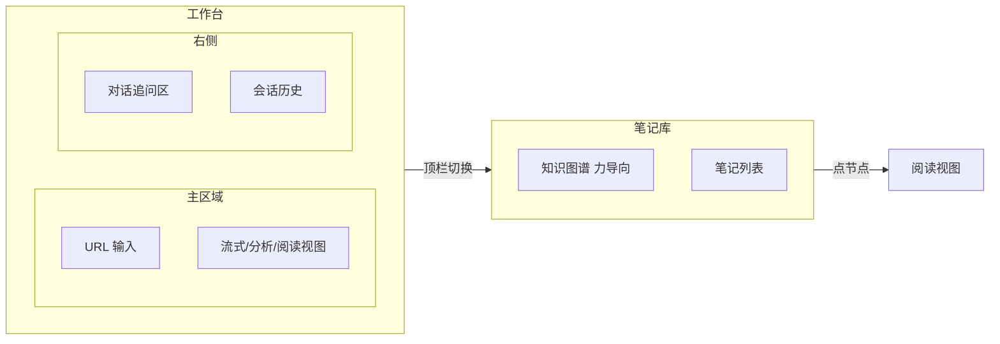
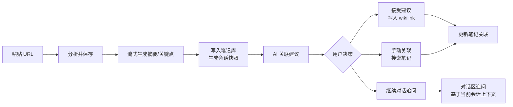

# 知识聚合器 PRD（产品需求文档）

> 用途：基于当前实现整理产品全貌，作为后续迭代的基线。
> 最后更新：2026-07-21。
> 产品形态：**独立的 Markdown 知识工具**--不绑定 Obsidian，笔记就是普通 `.md` 文件，落到一个本地目录；`[[wikilink]]` 是 Markdown 通用约定，Obsidian / Logseq / VSCode 等均可直接打开。

---

## 1. 产品定位

**一句话**：粘贴网页链接，AI 自动整理成结构化 Markdown 笔记，并基于会话和笔记库智能建议关联，用 `[[wikilink]]` 逐步构建个人知识网络。

**目标用户**：
- 用 Markdown 做知识管理的人（Obsidian / Logseq / VSCode 用户）。
- 经常收藏网页、公众号、论文，但「存完就忘」的人。
- 希望通过 AI 建立跨笔记知识连接，而不是手动维护图谱的人。

**核心价值**：
1. 省去「读完网页 -> 手写笔记 -> 手动打标签 -> 想关联哪些旧笔记」的全套手工流程。
2. 领域感知的摘要：技术文突出架构、教程突出步骤、产品文突出商业模式。
3. AI 建议关联 + 一键 `[[wikilink]]`，让知识网络自然生长。
4. 以「会话」为单位组织一次知识对话，既可对话追问，又能沉淀成可复用的笔记资产。

---

## 2. 竞品与差异定位

| 产品 | 类型 | 优点 | 局限（你的机会） |
|------|------|------|------------------|
| Cubox | 稍后阅读 + AI 摘要 | 剪藏体验好、阅读视图干净、跨平台完善 | 偏静态收藏，AI 多为单篇摘要，缺少长期知识网络与对话式追问 |
| Mem.ai | AI 原生笔记 | 自动关联、智能组织，适合日常碎片输入 | 输入多为手动笔记，对外部网页内容的「聚合 + 结构化」偏弱 |
| Heptabase | 白板知识库 | 强可视化、适合研究复杂主题 | 上手成本高，缺少「链接 -> 自动结构化笔记」的流式入口 |
| Felo / Perplexity | AI 搜索引擎 | 实时联网搜索，直接给出答案 | 缺少个人知识沉淀，问完即走，无法形成长期知识资产 |

**差异定位**：
- 入口是「网页链接 + 会话对话」，而不是空白笔记。
- 每一次分析既产出笔记，又作为可复用的会话历史。
- 强调 Markdown 输出 + `[[wikilink]]`，天然与 Obsidian / Logseq / VSCode 兼容，属于「外挂知识加工厂」。

---

## 3. 功能清单

### 3.1 核心流水线（当前已实现）
| 能力 | 说明 | 状态 |
|------|------|------|
| 网页抓取 | httpx 抓取 + trafilatura/bs4 双策略正文抽取，超长截断 | ✅ |
| AI 分析 | 调 Anthropic 兼容接口，按领域 Skill 输出结构化笔记 | ✅ |
| 流式输出 | 摘要正文逐字流式渲染到页面，生成完成切到结构化视图 | ✅ |
| 落盘笔记 | 写入 Markdown 文件（frontmatter + wikilink + mermaid）| ✅ |
| 关联建议 | AI 从已有笔记候选里挑相关篇目，带理由 + 相关度评分 | ✅ |
| 一键关联 | 勾选建议 -> 写 `[[wikilink]]` 到「关联笔记」小节，自动去重 | ✅ |
| 手动关联 | 输入笔记名搜索并添加链接（datalist 候选）| ✅ |
| 重新建议 | 对已落盘笔记重新跑关联建议 | ✅ |
| 会话快照 | 每次分析存 JSON 到系统临时目录，可恢复/清空 | ✅ |
| API 配置页 | 前端热更新 .env（AI 地址/密钥/模型/笔记目录/CORS）| ✅ |
| 领域 Skills | 8 个领域各自定义摘要结构 + 图解类型 | ✅ |
| Mermaid 图解 | AI 产出 mermaid 代码，Web Worker 渲染成 SVG | ✅ |
| 对话追问 | 基于当前笔记 + 关联笔记的流式多轮对话（`/api/chat/stream`）| ✅ |
| 知识图谱 | `[[wikilink]]` 关系渲染力导向图，按领域配色（`/api/graph`）| ✅ |
| 两页式布局 | 顶栏切换工作台 / 笔记库 | ✅ |
| 向量检索关联 | 本地 embedding 语义召回，与 LLM 建议互补（`/api/relate-semantic`、`/api/search`）| ✅ |
| 语义搜索 | 工作台搜索框，输入问题召回相关笔记 | ✅ |

### 3.2 领域 Skills（8 个领域）
技术/工程、教程/指南、产品/商业、金融/数据、学术/研究、资讯/动态、观点/评论、通用。每个领域定义摘要强调点 + 推荐的 mermaid 图类型（flowchart / mindmap）。

### 3.3 笔记格式
```markdown
---
title: ...
source: https://...
created: 2026-07-21
domain: tech
tags: [tag1, tag2]
---
# 标题
> **TL;DR**: 一句话总结
## 摘要
（结构化 markdown）
## 关键点
- ...
## 图解
```mermaid
（mermaid 代码）
```
## 关联笔记
- [[其他笔记]]
```

---

## 4. 布局设计

### 4.1 当前实现（单页两栏）
```
┌─────────────────────────────────────────────────┐
│  Header: 标题 + API配置链接 + StatusBar         │
├──────────────────────────┬──────────────────────┤
│  主区域（1fr）            │  侧栏（22rem）       │
│  UrlForm（始终顶部）      │  NoteList（笔记库）   │
│  ① StreamingCard         │  SessionHistory      │
│  ② NoteViewer（阅读）     │                      │
│  ③ AnalysisCard +        │                      │
│     SuggestionList +     │                      │
│     ManualLinkInput      │                      │
├──────────────────────────┴──────────────────────┤
│  Footer: 存储位置说明                            │
└─────────────────────────────────────────────────┘
```
主区域三态互斥：流式生成 / 阅读视图 / 分析视图。点击笔记在主区域全幅阅读（可「返回分析」）。

### 4.2 两页式布局（工作台 + 笔记库）✅ 已实现


**工作台模式**：中间是分析/阅读视图（流式生成 > 阅读 > 分析三态互斥），右侧是对话区（ChatPanel，基于当前笔记流式追问）+ 会话历史。

**笔记库模式**：中间是知识图谱（力导向布局，按领域配色，点节点打开阅读）或阅读视图，右侧是笔记列表。

> v1.2 已落地两页切换 + 对话区 + 图谱。PRD 原设想的「左侧会话列表 + 中间对话流 + 右侧阅读」三栏暂简化为两栏，后续可按需细化为三栏。

---

## 5. 核心交互流程

### 5.1 主流程


### 5.2 关键交互
| 用户操作 | 触发位置 | 系统响应 | 状态/数据变更 |
|----------|----------|----------|----------------|
| 粘贴 URL -> 分析并保存 | 主区域顶部 | 流式生成 -> 写入笔记库 -> 创建会话快照 | 新增一条会话、一条笔记 |
| 点击会话列表 | 侧栏 | 恢复该会话的分析视图 + 已关联笔记 | 主区域显示分析视图 |
| 点击笔记列表 | 侧栏 | 主区域切换到阅读视图 | 不改变当前会话，只切换阅读内容 |
| 勾选 AI 建议 -> 确认关联 | 分析区 | 写入 `[[wikilink]]` 到目标笔记「关联笔记」小节 | 更新 md 文件，刷新关联 |
| 手动搜索并关联 | 分析区 | 搜索笔记名，插入 `[[wikilink]]` | 同上 |
| 对话区追问 | 中间栏 📍规划 | AI 基于当前会话上下文和已关联笔记回答 | 产生新对话轮次，可引用新笔记 |
| 阅读视图划线 -> 发送到对话 | 右侧栏 📍规划 | 选中片段作为上下文加入对话输入框 | 对话带上片段引用 |

---

## 6. 状态与权限模型

### 6.1 核心实体
- **User（用户）**：可选匿名（无账号）/ 注册用户（多端同步）。
- **笔记库**：一套 Markdown 文件夹（可配 iCloud / Git 同步）。
- **Session（会话）**：每次分析生成一个，含来源 URL、笔记 ID、对话历史、快照路径。
- **Note（笔记）**：一篇 Markdown 文件，含 frontmatter、正文、关联笔记。

### 6.2 状态字段（📍规划）
- `note.status`：`draft`（草稿）/ `archived`（归档）/ `deleted`（已删除）。
- `session.status`：`active`（活跃）/ `archived`（归档）。

### 6.3 权限与可见性
- 用户对自己的笔记库有完全读写权限。
- 未来支持「共享笔记库」时增加：`vault.visibility`（private / shared / public）、`note.shared_with`（用户/团队粒度）。

---

## 7. 技术架构

```
浏览器 (Next.js 16 / React 19 / Tailwind 4)
  │  fetch / SSE
  ▼
FastAPI (Python 3.11)
  ├── scraper   抓取 + 正文抽取
  ├── ai        Anthropic 兼容接口（含流式）
  ├── skills    领域 Skill 定义
  ├── vault     Markdown 笔记读写
  ├── linker    关联建议胶水层
  ├── session   临时会话快照
  └── config    .env 热更新
  │
  ├──-> 文件系统：notes/*.md（Markdown 笔记，可配 iCloud/Git 同步）
  ├──-> 系统 temp：knowledge-sessions/*.json（可删）
  └──-> 内部 AI 网关：/v1/messages
```

**前端分层**：`app/page.tsx`(状态编排) -> `components/`(展示) -> `hooks/`(数据获取) -> `lib/api.ts`(网络) -> `lib/types.ts`(类型)。

**建议新增模块**：
- `session_manager`：统一管理会话快照生命周期。
- `cache`：对 `note_candidates()` 结果做缓存（避免每次全量读所有笔记）。

---

## 8. 商业模式：开源核心 + 闭源云服务（open-core）

| 层级 | 形态 | 定价 | 价值 |
|------|------|------|------|
| 本地 BYO-key | 当前开源版 | 免费 | 攒用户和信任，数据不出本机 |
| 托管云版 | SaaS 订阅 | 月付 | 托管 AI（免折腾 key）、云同步、多端、向量检索 |
| 团队版 | 高价订阅 | 按席位 | 共享笔记库、协作关联、权限管理 |

**GTM**：开源核心获客 -> 云版变现。PKM 领域被 Obsidian/Logseq 验证过的路径（本地免费，Sync/Publish 收费）。

**License 建议**：核心用 MIT（最宽松，最大化采用）；若担心云厂商 fork 托管，改 AGPL-3.0。云服务条款单独写，禁止未授权托管。注册商标保护品牌。

---

## 9. 产品优化方向（按价值优先级）

| 方向 | 现状 | 优化目标 |
|------|------|----------|
| **知识网络** | 单向 `[[wikilink]]` 手动确认 | 全局图谱可视化（D3/Cytoscape 力导图）、增量重分析、标签聚类、全文搜索 |
| **输入源** | 仅 URL | PDF / 本地文件 / YouTube 字幕 / RSS 订阅 / 浏览器扩展 |
| **AI 关联** | LLM 逐条建议（贵且慢） | 向量嵌入语义召回（一次性索引，O(log n) 检索），LLM 仅做精排与理由 |
| **AI 成本** | 单模型 | 路由：轻量模型做分流/分类，强模型做摘要；缓存已分析 URL |
| **UX** | 表单驱动 | 命令面板（⌘K）、每日回顾、间隔复习、对话式追问 |

---

## 10. 迭代路线图

### P0 - v1.0.0 发布前必做
- [ ] **git 初始化**：根目录还不是 git 仓库，且 `frontend/` 有嵌套 `.git`（create-next-app 遗留）。命令：
  ```bash
  rm -rf frontend/.git
  git init && git add . && git commit -m "feat: v1.0.0"
  ```
- [x] **密钥审计**：代码无硬编码 token；`backend/.env` 是唯一含密钥文件（已 `.gitignore`）
- [x] **.gitignore**：排除 .env / .venv / node_modules / .next / notes/*.md / .logs / __pycache__
- [x] **CHANGELOG.md**：Keep a Changelog 格式 ✓
- [x] **vault/.gitkeep**：保留目录但不提交笔记内容 ✓
- [ ] **部署方案**：见 [DEPLOYMENT.md](DEPLOYMENT.md)
- [ ] **流式错误恢复**：流式生成中途失败时的断点续传或明确重试
- [ ] **前端错误状态**：清晰区分错误类型（网络 / AI / 抓取失败）

### P1 - 体验提升
- **笔记编辑**：在线编辑正文并写回笔记库（免切外部编辑器）
- **批量分析**：一次粘贴多个 URL，后台队列处理
- **全文搜索**：笔记库内容全文检索（后端索引或前端小索引）
- **知识图谱可视化**：用 `[[wikilink]]` 关系渲染全局图谱（force-directed graph）
- **导出**：单篇 / 全部导出为 Markdown 包

### P2 - 智能增强（核心差异化）
- ✅ **向量检索关联**：embedding 语义召回替代/补充 LLM 逐条判断（已实现，本地 sentence-transformers）
- **笔记去重检测**：分析前检查高度相似笔记，提示合并或打标签
- **多模型路由**：轻量模型分流 + 强模型摘要，缓存已分析 URL 降成本
- **自定义 Skill**：用户自定义领域模板（PRD 模板、读书笔记模板等）
- **输入源扩展**：PDF / 本地文件 / YouTube 字幕 / RSS / 浏览器扩展

### P3 - 平台化
- **浏览器扩展**：右键当前页面 -> 发送分析
- **命令面板**（⌘K）/ **每日回顾** / **间隔复习**
- **编辑器集成**：在 VSCode / Obsidian 中直接调用 API 分析当前链接
- **移动端适配 / PWA**
- **图谱增强**：拖拽节点、按标签筛选子图、图谱上直接加连边

---

## 11. 安全与数据治理

### 11.1 密钥与配置管理
- 所有 AI 密钥通过环境变量或密钥管理服务注入，禁止硬编码。
- 前端配置页只允许更新「允许热更新的字段」（笔记目录、模型名等），敏感字段通过受控接口写入。
- 公开版须改为 BYO key 或代理限流；移除 `/api/settings` 热更新接口。

### 11.2 抓取与内容版权
- 抓取行为遵循目标站点 `robots.txt`，仅做个人学习/研究用途。
- 保存快照时保留原站链接、标题、作者信息，方便溯源。
- 如未来提供公开服务，需评估抓取与存储的版权风险。

### 11.3 数据隐私
- 默认所有数据仅在用户本地笔记目录存储，不上传云端。
- 若提供云同步服务，需明确数据存储位置、加密方式、访问控制策略。

### 11.4 工程安全
- SSRF 防护：scrape 禁止访问内网 IP（10.x / 172.16-31.x / 192.168.x / localhost）。
- 请求限流：防滥用（BYO key 版按 IP 限流）。
- 关联建议 filename 白名单校验：防 AI 幻觉出不存在的笔记（已实现）。

---

## 12. 工程化规范（已做 + 路线图）

**已做**：`.gitignore`、CHANGELOG、密钥审计、分层架构、`folder-alias.json` 文件索引、类型对齐（`models.py` ↔ `lib/types.ts`）。

| 领域 | 项 | 状态 |
|------|-----|------|
| 仓库 | Conventional Commits、GitHub Actions（lint/typecheck/test）| 📍规划 |
| 后端 | ruff（lint+format）、pytest（frontmatter 解析/JSON 提取/链接去重）、结构化日志、限流、SSRF 防护 | 📍规划 |
| 前端 | prettier、Playwright e2e、Error Boundary、loading skeleton、i18n | 📍规划 |
| API 治理 | `/api/v1` 版本前缀；**OpenAPI schema 自动生成前端类型**（消除手写 types.ts 同步成本）| 📍规划 |
| 可观测 | AI 调用成本/延迟埋点、请求日志 | 📍规划 |
| 部署 | Docker 镜像发布 registry、prod compose 加 TLS + healthcheck | 📍规划 |

---

## 13. 核心指标与埋点建议

### 13.1 使用指标
- 分析成功率、平均耗时、流式首字耗时。
- 关联建议采纳率（确认关联数 / 建议总数）。
- 笔记复访率（阅读视图打开次数 / 笔记数）。
- 会话恢复率（从历史恢复次数 / 总分析次数）。

### 13.2 活跃与留存
- 日活 / 周活（DAU / WAU）。
- 次日/七日/三十日留存（Day1 / Day7 / Day30 Retention）。
- 平均每次会话对话轮次、平均每笔记被引用次数。

### 13.3 性能与稳定性
- 接口错误率（按类型：抓取 / AI / 文件 IO）。
- 会话快照损坏率（恢复失败次数 / 总恢复次数）。
- 平均笔记库大小、笔记数量上限经验值。
- AI 调用成本 / 延迟（P2 多模型路由的基础）。

---

## 14. 约束与风险

| 约束 | 说明 |
|------|------|
| AI 密钥 | 当前用内部网关 token，公开版必须改为 BYO key 或代理限流 |
| 本地笔记 | Web 版无法写本地文件系统，需下载或改桌面端（见 DEPLOYMENT.md）|
| 抓取能力 | 纯 httpx 抓不了 JS 渲染页面（SPA），需 Playwright 兜底 |
| 笔记量 | `note_candidates()` 每次全量读所有笔记取 tldr，量大后变慢，需缓存 |
| mermaid | 复杂图渲染会卡顿，已用 Web Worker 优化（DOM 依赖时降级主线程）|
| 嵌套 git | `frontend/.git` 需移除后才能在根目录统一 git init |
| Python 3.8 | 需 `eval_type_backport`；升级 3.9+ 后可移除 |
